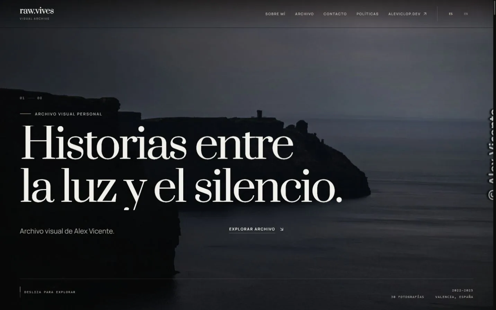
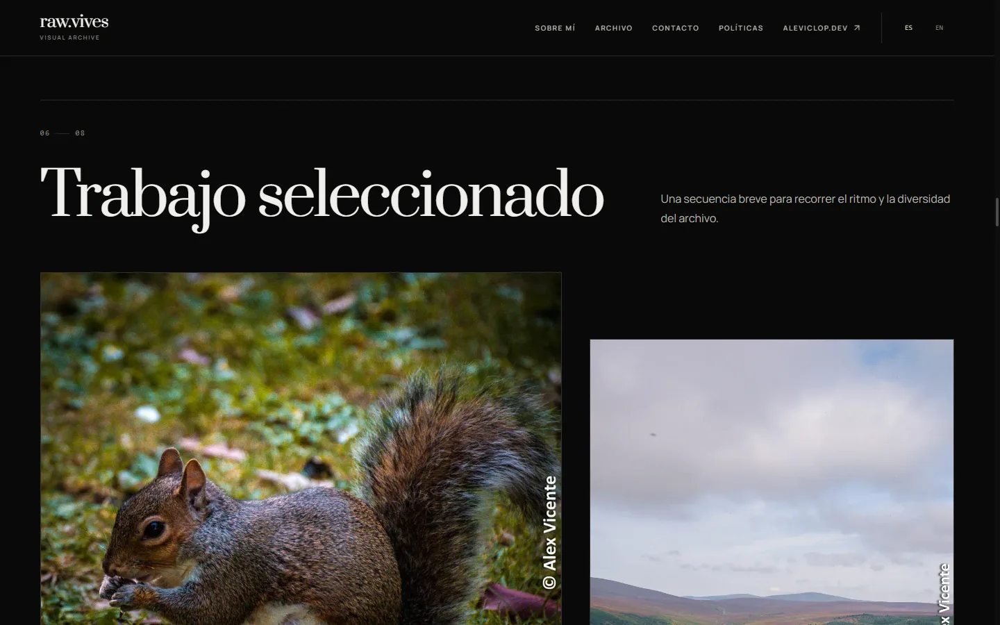
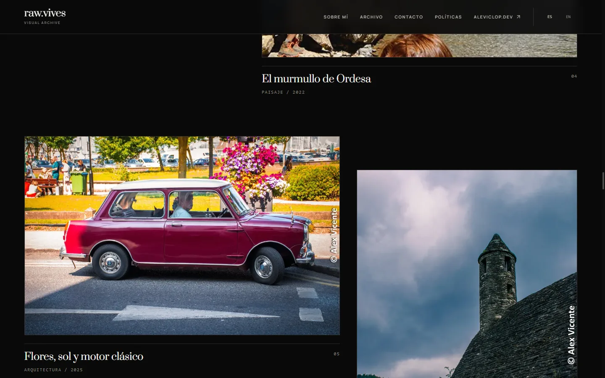
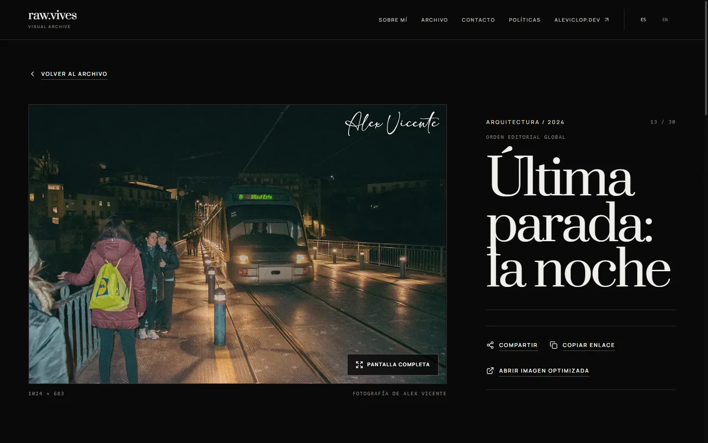
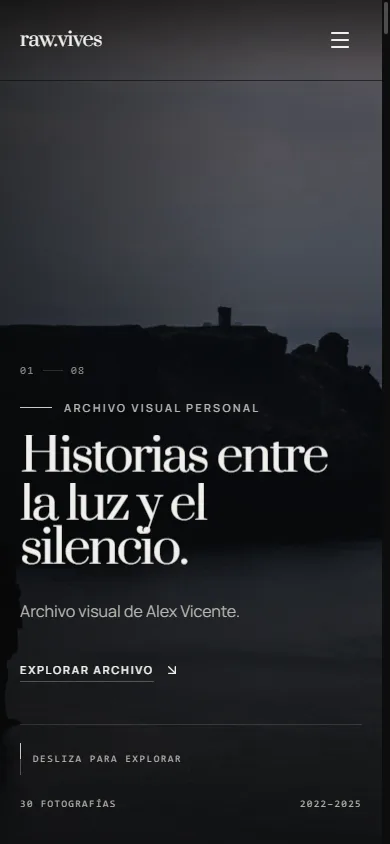

<div align="center">

# raw.vives

### A personal visual archive

**Photography × Art Direction × Creative Development**

Un archivo fotográfico personal de **Alex Vicente**, diseñado como una experiencia editorial donde las imágenes tienen el protagonismo y la tecnología hace posible explorarlas.

**[Explorar la galería](https://rawvives.aleviclop.dev)** · **[Ver archivo](https://rawvives.aleviclop.dev/es/archive)** · **[Portfolio de desarrollo](https://www.aleviclop.dev)** · **[Contacto](mailto:alexviclop@gmail.com)**

</div>



<div align="center"><sub>Captura del proyecto incluida en el repositorio. La interfaz publicada puede variar respecto a esta versión.</sub></div>

---

## El proyecto

**raw.vives** nace de una idea sencilla: las fotografías merecen algo más que una cuadrícula de miniaturas. Quería construir un lugar propio para presentar imágenes, series y recuerdos visuales con una narrativa clara, sin convertir mi afición por la fotografía en un servicio comercial.

También es un proyecto de desarrollo frontend: explora cómo combinar **dirección de arte, interfaces interactivas, tratamiento de imágenes, accesibilidad y rendimiento** dentro de una experiencia que sigue funcionando cuando los efectos visuales no están disponibles.

| | |
| :--- | :--- |
| **Mi papel** | Concepto, fotografía, diseño y desarrollo |
| **Formato** | Archivo fotográfico y experiencia editorial |
| **Idiomas** | Español e inglés |
| **Arquitectura** | Next.js con exportación estática |
| **Distribución** | Cloudflare Pages |
| **Visitar** | [rawvives.aleviclop.dev](https://rawvives.aleviclop.dev) |

## Explorar la experiencia

### 01 — Narrativa visual

Una portada que introduce el lenguaje fotográfico mediante composición, escala, tipografía y transiciones controladas. La interfaz acompaña a las imágenes en lugar de competir con ellas.



### 02 — Archivo fotográfico

Un archivo de **31 fotografías** con búsqueda, filtros por categoría y año, opciones de ordenación y carga progresiva. El estado de los filtros puede compartirse mediante la URL.



### 03 — Una página para cada fotografía

Cada imagen dispone de su propia ruta, contenido contextual, metadatos, navegación entre fotografías, vista a pantalla completa y obras relacionadas. Esto permite explorar el trabajo sin perder la continuidad del archivo.



### 04 — Experiencia móvil

El diseño se adapta a pantallas pequeñas y mantiene las mismas prioridades: imágenes legibles, navegación accesible y controles utilizables con el dedo.



## Diseño y decisiones técnicas

| Desafío | Solución |
| :--- | :--- |
| **Crear una galería con identidad** | Composición editorial, jerarquía tipográfica, fotografía a gran escala y un sistema visual contenido. |
| **Mostrar imágenes de forma eficiente** | Procesamiento con Sharp, variantes WebP/AVIF, placeholders y recursos responsivos. |
| **Permitir descubrir y compartir fotografías** | Archivo con filtros reflejados en la URL y páginas individuales indexables. |
| **Añadir movimiento sin excluir visitantes** | GSAP, cursor contextual y WebGL como mejoras progresivas, desactivadas cuando el dispositivo o la accesibilidad lo requieren. |
| **Ofrecer dos idiomas** | Diccionarios ES/EN, rutas localizadas, metadata y textos alternativos adaptados. |
| **Simplificar operación y alojamiento** | Generación estática, distribución por CDN y despliegue en Cloudflare Pages. |
| **Proteger los originales** | Validaciones del pipeline y exclusión de archivos fuente privados del artefacto distribuido. |

El objetivo no es demostrar cuántos efectos se pueden añadir, sino **cuándo merece la pena utilizarlos y cuándo es mejor prescindir de ellos**.

## Tecnologías

**Interfaz:** Next.js 16 · React 19 · TypeScript · Tailwind CSS 4

**Movimiento y gráficos:** GSAP · Three.js · Lenis

**Fotografía y optimización:** Sharp · EXIF · WebP · AVIF

**Calidad y distribución:** Node.js · pnpm · Playwright · GitHub Actions · Cloudflare Pages

Las versiones instaladas se resuelven mediante `pnpm-lock.yaml`.

---

<details>
<summary><strong>Instalación y desarrollo local</strong></summary>

### Requisitos

- Node.js 24.18.0 (rango 24.x compatible según `package.json`)
- pnpm 11.20.0
- Git

### Inicio rápido

```bash
git clone https://github.com/AVL05/alexgallery.git
cd alexgallery
corepack enable
pnpm install --frozen-lockfile
pnpm dev
```

Para configurar las URLs públicas del sitio, copia `.env.example` a `.env.local` y revisa:

```dotenv
NEXT_PUBLIC_BASE_URL=http://localhost:3000
```

La variable indica el origen que utilizará el proyecto para URLs y metadatos. No se necesita una API de pago para explorar localmente el archivo.

### Comandos principales

| Comando | Descripción |
| :--- | :--- |
| `pnpm dev` | Servidor de desarrollo. |
| `pnpm optimize-images` | Genera variantes y metadatos fotográficos. |
| `pnpm typecheck` | Verificación de tipos. |
| `pnpm test` | Tests automatizados. |
| `pnpm e2e` | Pruebas de navegador con Playwright. |
| `pnpm build` | Valida y prepara la exportación estática. |
| `pnpm preview` | Vista previa mediante Wrangler. |
| `pnpm check` | Validaciones de tipos, lint, tests y build. |
| `pnpm deploy:pages` | Genera y envía un despliegue a Cloudflare Pages; requiere credenciales y configuración. |

**Nota:** en esta versión, `pnpm lint` ejecuta la comprobación de TypeScript; no es un proceso de ESLint independiente. La suite E2E existe como comando, pero no forma parte del script `pnpm check`.

</details>

<details>
<summary><strong>Arquitectura y publicación</strong></summary>

```text
app/              Rutas, layouts y metadatos
components/       UI, narrativa, archivo, motion y detalle
dictionaries/     Contenido localizado ES/EN
hooks/            Hooks de interacción y capacidades
lib/              Datos, filtros, configuración y SEO
public/photos/    Recursos fotográficos para la web
scripts/          Preparación, optimización y validación
functions/        Funciones y middleware de Cloudflare
tests/            Tests automatizados
docs/             Diseño, arquitectura, auditorías y releases
```

### Exportación estática

La aplicación utiliza `output: "export"` para generar páginas y recursos estáticos. Los cambios en el contenido fotográfico requieren una nueva compilación.

El procesamiento fotográfico prepara imágenes optimizadas y verifica que los archivos privados de origen no terminen en la salida pública.

### Accesibilidad y SEO

La experiencia contempla navegación por teclado, foco visible, enlaces de salto, alternativas de movimiento reducido, colores forzados y degradación progresiva de gráficos. Incluye rutas localizadas, canonical, `hreflang`, sitemap, robots, Open Graph y datos estructurados.

Estas decisiones son objetivos de ingeniería y comprobaciones del proyecto; **no implican una certificación de accesibilidad ni métricas de producción garantizadas**.

### Publicación

El código incluye integración continua y herramientas de despliegue en Cloudflare. La disponibilidad de la web pública no demuestra por sí sola que el último commit esté desplegado: debe validarse cada release.

- [Arquitectura](docs/RAW_VIVES_ARCHITECTURE.md)
- [Sistema de archivo](docs/RAW_VIVES_ARCHIVE_SYSTEM.md)
- [Sistema de diseño](docs/RAW_VIVES_DESIGN_SYSTEM.md)
- [Caso de estudio](docs/RAW_VIVES_CASE_STUDY.md)
- [Proceso de despliegue](docs/RAW_VIVES_DEPLOYMENT.md)
- [Auditoría técnica](docs/RAW_VIVES_PRODUCTION_AUDIT.md)

</details>

---

## Sobre el autor

Soy **Alex Vicente**, desarrollador web de Valencia (España) y aficionado a la fotografía y al vídeo. raw.vives reúne estas dos facetas: mi interés por capturar escenas con una mirada cinematográfica y el deseo de diseñar una experiencia digital propia para presentarlas.

La fotografía aquí es una **práctica personal y creativa**, no una oferta de sesiones o encargos profesionales.

**[Ver fotografía](https://rawvives.aleviclop.dev)** · **[Portfolio de desarrollo](https://www.aleviclop.dev)** · **[GitHub](https://github.com/AVL05)** · **[LinkedIn](https://www.linkedin.com/in/aleviclop/)**

## Derechos y uso de las imágenes

© 2026 Alex Vicente López. **Todos los derechos reservados.**

Las fotografías, el diseño y los contenidos visuales no se ofrecen para reutilización libre. Se puede enlazar a la galería; para reproducir, publicar, licenciar o utilizar una imagen se debe solicitar autorización previamente a **[alexviclop@gmail.com](mailto:alexviclop@gmail.com)**.

El repositorio no declara una licencia de código abierto. Consulta el archivo [LICENSE](LICENSE) para conocer las condiciones.
